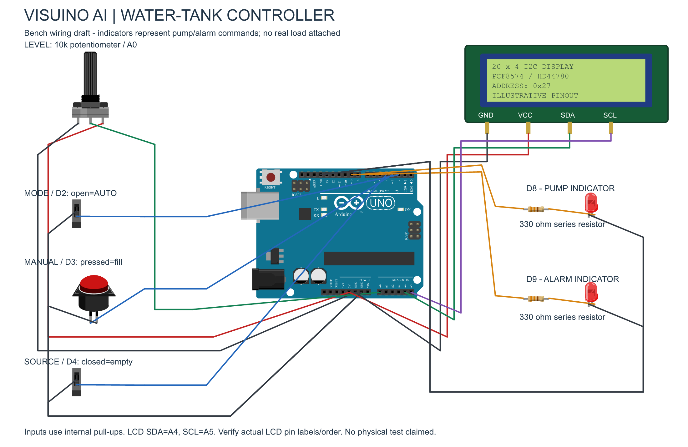

# Visuino AI Water-Tank Controller

Build an Arduino Uno water-tank controller with Visuino AI, then inspect its
actual compiled firmware in Circuit Lab. The project includes automatic and
manual control, shared stop conditions, and a 20×4 I2C display.

[Watch the complete walkthrough](https://www.youtube.com/watch?v=VGi7qFAkXQc).

## Control behavior

- Automatic filling starts at or below **25%** and stops at or above **80%**.
- Between those thresholds, the automatic request retains its previous state.
- Manual filling follows a momentary button while manual mode is selected.
- Both modes require source water and a tank level **below 95%**.
- The alarm indicates an empty source or tank level **at or above 95%**.
- The LCD displays level, mode, pump command and alarm, refreshing twice a second.

The demonstration compiled and ran the actual generated program in Lab preview.
This is not a physical pump installation: the wiring example uses a potentiometer
for tank level and LEDs for output commands. Real hardware was not tested.

## Files

| File | Purpose |
|---|---|
| [Visuino project](Visuino-AI-Water-Tank-v2.visuino) | Editable native graph, created with Visuino Pro 8.0.0.169 |
| [Generated Arduino sketch](WaterTankController.ino) | Exact sketch paired with the native graph |
| [Editable Fritzing drawing](Water-Tank-Controller-Wiring.fzz) | Bundled wiring project |
| [Wiring PNG](Water-Tank-Controller-Wiring.png) | Readable connection guide |
| [Wiring SVG](Water-Tank-Controller-Wiring.svg) | Vector connection guide |
| [Illustrative LCD part](FAH-20x4-I2C-illustrative.fzpz) | Original external four-pin LCD representation |
| [Graphic attribution](ATTRIBUTION.md) | Fritzing graphic authors and CC BY-SA 3.0 terms |
| [Connectivity check](connectivity-check.json) | Saved wiring connectivity inspection |

## Connections

| Uno pin | Function |
|---|---|
| A0 | 10 kΩ level-test potentiometer wiper, mapped from 0..1 to 0..100% |
| D2 | Mode pull-up: HIGH = automatic; LOW = manual |
| D3 | Manual button to GND, active-low |
| D4 | Source-empty switch to GND, active-low |
| D8 | Pump-command LED through a 330 Ω series resistor |
| D9 | Alarm LED through a 330 Ω series resistor |
| A4 / SDA | LCD SDA |
| A5 / SCL | LCD SCL |
| 5V / GND | Compatible module power and common ground |

Inputs use internal pull-ups and 40 ms debounce. Outputs initialize LOW.
The LCD is a compatible HD44780 / PCF8574 20×4 module at address **0x27**.
Check your actual module's labels, pin mapping and voltage. The custom LCD part
is an illustrative external interface, not a manufacturer-specific PCB footprint.

The image is a connection guide, not a physical breadboard-hole layout. Use
suitable shared power rails. Wire crossings are separate unless explicitly joined.
Never connect a pump, motor or relay coil directly to an Uno output; real loads
require an appropriate driver and power supply.

## Open and build

1. Open the `.visuino` file in a compatible licensed Visuino installation.
2. Inspect the graph and board settings, then generate the Arduino sketch.
3. Install dependencies through legitimate Visuino/Arduino sources and build for
   **Arduino Uno (`arduino:avr:uno`)**. Proprietary Mitov libraries are not included.
4. The supplied sketch is provided for inspection and reproducibility. If opening
   it directly in Arduino IDE, place it in a folder named `WaterTankController`.
5. Open the `.fzz` in Fritzing. The illustrative LCD is bundled; the separate
   `.fzpz` is supplied for reuse if needed.

The recorded exact sketch compiled with **11,174 bytes of flash** and **416 bytes
of static RAM**. Other toolchains may produce different sizes. Compilation,
simulation and physical testing are separate checks.

## Test the controller

Run the actual generated program using a supported Circuit Lab fixture. Check:

1. Automatic low/high transitions and memory inside the 25–80% band.
2. Manual button press and release, with automatic mode excluded.
3. Empty-source stop and alarm while a fill request is active.
4. The 95% stop and alarm in both automatic and manual modes.
5. All four display rows and their twice-per-second refresh.

Use actual sampled ADC values when checking inclusive thresholds; rounded LCD
percentages can hide the exact boundary. Observe real firmware GPIO/LCD output,
not a separate model that merely imitates the expected result.

## Project links

- [Video walkthrough](https://www.youtube.com/watch?v=VGi7qFAkXQc)
- Instructables: step-by-step article is being prepared; its public URL will be
  added after publication.
- Homepage project page: public URL will be added after publication.

## Credits and rights

Project concept: **Finn André Hotvedt**. Visuino: **Boian Mitov / Mitov Software**.
AI-assisted implementation and documentation: **OpenAI Codex**.
Wiring graphics use Fritzing core artwork plus an original illustrative LCD;
see [ATTRIBUTION.md](ATTRIBUTION.md) for **CC BY-SA 3.0** terms.
No third-party software or library license is granted by this repository.
No additional software license has been assigned to the native/generated source.
